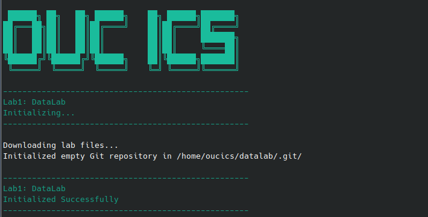
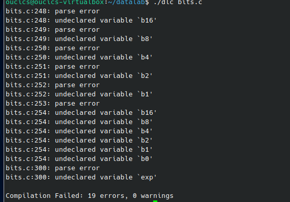
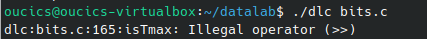
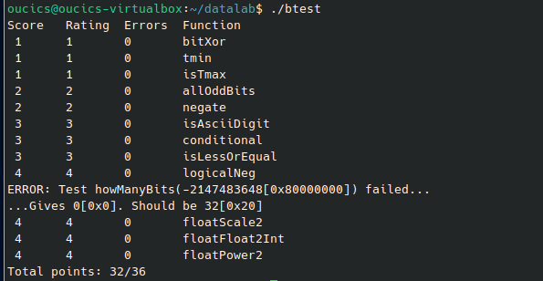
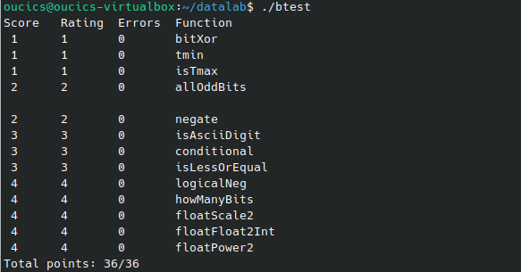
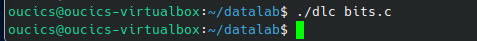

\tableofcontents
\newpage

# 一、 实验环境配置与开发工具选择

在 Linux 虚拟机中，首先使用官方脚本完成了 `datalab` 目录的初始化。



在实验初期，我尝试在虚拟机的终端中直接使用文本编辑器修改代码。但终端操作在处理长文件时不够直观，稍有不慎就会误触或破坏原文件中的注释，且编译报错后的代码定位极其困难。为了提高开发效率，我查阅了讲义提示，通过配置 VirtualBox 的 NAT 端口转发，在 Windows 宿主机上使用 VSCode 的 SSH 插件连接到了虚拟机。此后，所有的代码编写、测试与规范检查均在 VSCode 中配合终端完成。

\newpage

# 二、 题目实现与逻辑推导

本次实验共包含 13 个函数，主要考察位运算、补码特性以及浮点数标准。以下是我在实现每道题时的详细推导过程。

## 1. 基础整数位运算

### 1.1 bitXor

\begin{mybluebox}
\textbf{题目要求：}仅使用 \textasciitilde{} 和 \& 实现异或运算，最大操作符数量 14。

\textbf{思维推导：}
异或运算的逻辑是“相同为 0，不同为 1”。我首先想到的基础逻辑公式是：(x \& \textasciitilde{}y) | (\textasciitilde{}x \& y)，即“x为1且y为0”或者“x为0且y为1”。
但由于题目严格禁止使用按位或运算符 |，我必须寻找替代方案。回顾离散数学中的德摩根定律，有 A | B = \textasciitilde{}(\textasciitilde{}A \& \textasciitilde{}B)。
将 A 和 B 代入，即可推导出不使用或运算符的最终表达式。
\end{mybluebox}

```c
int bitXor(int x, int y) {
  return ~(~(x&~y)&~(~x&y));
}
```

### 1.2 tmin

\begin{mybluebox}
\textbf{题目要求：}返回 32 位补码最小值，最大操作符数量 4。

\textbf{思维推导：}
32 位有符号整数的最小值是 -2147483648，其二进制补码表示为 0x80000000。也就是说，除了最高位的符号位是 1，其余全是 0。
起初我想直接返回该常量，但这会触发编译器对常量的限制。根据补码的位权定义，最高位的 1 代表 2 的 31 次方取负。因此，直接将 1 左移 31 位，即可完美构造这个特殊值。
\end{mybluebox}

```c
int tmin(void) {
  return 1<<31;
}
```

### 1.3 isTmax

\begin{mybluebox}
\textbf{题目要求：}判断 x 是否为最大值，禁用位移操作，最大操作符数量 10。

\textbf{思维推导：}
32 位最大值为 0x7FFFFFFF。观察其二进制特性发现：将其取反得到 0x80000000，而将其加 1 也会得到 0x80000000。因此最大值满足条件 \textasciitilde{}x == x + 1。
但这引出了一个陷阱：当 x = -1 (0xFFFFFFFF) 时，取反为 0，加 1 也为 0，同样满足上述等式。必须排除 -1。
由于禁用右移，我无法用位移判断符号位。但我可以利用逻辑非 ! 对布尔值敏感的特性：对 -1 取反得到 0，再取逻辑非 !!\textasciitilde{}x 得到 0；对最大值取反是非零值，逻辑非后得到 1。这样就能安全排除 -1。
\end{mybluebox}

```c
int isTmax(int x) {
  return !(~x^(x+1))&!!~x;
}
```

### 1.4 allOddBits

\begin{mybluebox}
\textbf{题目要求：}奇数位全为 1 则返回 1，禁用大于 255 的常量，最大操作符数量 12。

\textbf{思维推导：}
32 位整数的奇数位（1,3,5...31）全为 1，其掩码应该是 0xAAAAAAAA。我的初步思路是将 x 与该掩码相与，看结果是否等于掩码。
但是题目不允许直接使用这样的大常量。我只能用小常量 0xAA 通过位移和逻辑或拼接：(0xAA<<24) | (0xAA<<16) | (0xAA<<8) | 0xAA。
利用异或 ^ 可以判断两数是否相等（相等则结果为0），最后加一个 ! 将结果反转作为布尔返回值。
\end{mybluebox}

```c
int allOddBits(int x) {
  int mask = (0xAA<<24)|(0xAA<<16)|(0xAA<<8)|0xAA;
  return !((x&mask)^mask);
}
```

### 1.5 negate

\begin{mybluebox}
\textbf{题目要求：}返回 -x，最大操作符数量 5。

\textbf{思维推导：}
在计算机组成原理中，补码系统求一个数的相反数的标准步骤是“按位取反，末位加一”。直接套用此规律即可。
\end{mybluebox}

```c
int negate(int x) {
  return ~x+1;
}
```

## 2. 进阶逻辑与比较

### 2.1 isAsciiDigit

\begin{mybluebox}
\textbf{题目要求：}判断 x 是否属于 [0x30, 0x39]，最大操作符数量 15。

\textbf{思维推导：}
最直观的方法是判断 x >= 0x30 且 x <= 0x39。在位运算中，大于等于可以转换为相减后看符号位（最高位是否为 0）。
计算 x - 0x30（转化为 x + (\textasciitilde{}0x30+1)），如果结果为负，说明 x < 0x30；
计算 0x39 - x（转化为 0x39 + (\textasciitilde{}x+1)），如果结果为负，说明 x > 0x39。
将两个结果按位或，统一右移 31 位提取符号位。如果符号位为 0，说明两者都没有借位，在合法范围内。
\end{mybluebox}

```c
int isAsciiDigit(int x) {
  int lower = x+(~0x30+1);
  int upper = 0x39+(~x+1);
  return !((lower|upper)>>31);
}
```

### 2.2 conditional

\begin{mybluebox}
\textbf{题目要求：}实现三目运算符 x ? y : z，最大操作符数量 16。

\textbf{思维推导：}
这题的核心是构造一个掩码（Mask）。当 x 不为 0 时，需要全 1 掩码选中 y；当 x 为 0 时，需要全 0 掩码（即其反码全 1）选中 z。
第一步：利用两次逻辑非 !!x 将 x 归一化为 1 或 0。
第二步：利用补码特性，对 1 取反加一 \textasciitilde{}(1)+1 会得到全 1，对 0 取反加一仍是 0。所以 \textasciitilde{}(!!x)+1 就是完美的掩码。
第三步：将掩码与 y 按位与，将掩码的反码与 z 按位与，最后合并。
\end{mybluebox}

```c
int conditional(int x, int y, int z) {
  return ((~(!!x)+1)&y)|(~(~(!!x)+1)&z);
}
```

### 2.3 isLessOrEqual

\begin{mybluebox}
\textbf{题目要求：}判断 x <= y，最大操作符数量 24。

\textbf{思维推导：}
最直接的方法是判断 y - x 的符号位。但这隐藏着一个巨大的溢出风险：如果 x 是负数，y 是正数，y - x 可能会超出 32 位补码的正数上限，导致符号位反转（变为负数），从而得出错误的结论。
因此必须分类讨论：先提取 x 和 y 的符号位（右移 31 位）。
情况 1：异号。如果 x 为负且 y 为正，则必然 x <= y。
情况 2：同号。此时相减绝对不会溢出，直接判断 y - x 的符号位是否为 0 即可。
最后将两种情况用逻辑或和按位与结合，并使用 !! 规范化为 1 或 0 返回。
\end{mybluebox}

```c
int isLessOrEqual(int x, int y) {
  int sx = x>>31;
  int sy = y>>31;
  int diff = y+~x+1;
  int sd = diff>>31;
  return !!((sx&~sy)|(~(sx^sy)&~sd));
}
```

### 2.4 logicalNeg

\begin{mybluebox}
\textbf{题目要求：}实现逻辑非 !，最大操作符数量 12。

\textbf{思维推导：}
逻辑非的作用是：x 为 0 时返回 1，x 非 0 时返回 0。
对于非 0 的数，无论正负，其本身和它的相反数（补码）的符号位一定一个是 0，一个是 1。即 x | (\textasciitilde{}x+1) 的结果最高位必然是 1。如果 x 是 0，这个结果还是 0。
因此，提取 x | (\textasciitilde{}x+1) 的符号位（右移 31 位），得到的将是全 1（若非0）或 0（若为0）。对其加 1，刚好可以得到正确的 0 或 1。
\end{mybluebox}

```c
int logicalNeg(int x) {
  int y = x|(~x+1);
  return (y>>31)+1;
}
```

## 3. 复杂算法与浮点数

### 3.1 howManyBits

\begin{mybluebox}
\textbf{题目要求：}求补码表示的最小位数，最大操作符数量 90。

\textbf{思维推导：}
如果是正数，需要找最高位的 1 的位置；如果是负数，需要找最高位的 0 的位置。为了统一处理，我利用符号位 sign = x>>31，将负数取反（x ^ sign），这样正负数的处理逻辑就一致了。
但题目不允许写 while 循环。我采用了二分的思路：先看高 16 位是否存在有效位，如果有，则说明至少需要 16 位，把 x 右移 16 位继续判断。接着看 8 位、4 位、2 位、1 位。最后把所有命中的跨度加起来，并在最后加上符号位本身占的 1 位。
\end{mybluebox}

```c
int howManyBits(int x) {
  int sign = x>>31;
  int b16,b8,b4,b2,b1,b0;
  x = x^sign;
  b16 = !!(x>>16)<<4; x = x>>b16;
  b8 = !!(x>>8)<<3; x = x>>b8;
  b4 = !!(x>>4)<<2; x = x>>b4;
  b2 = !!(x>>2)<<1; x = x>>b2;
  b1 = !!(x>>1)<<0; x = x>>b1;
  b0 = x;
  return b16+b8+b4+b2+b1+b0+1;
}
```

### 3.2 floatScale2

\begin{mybluebox}
\textbf{题目要求：}浮点数乘 2，最大操作符数量 30。

\textbf{思维推导：}
必须严格按照 IEEE 754 标准提取三个部分：符号 sign、阶码 exp、尾数 frac。
乘 2 意味着浮点数的阶数增加 1。但需要特判：
1. exp 为 0xFF 时，表示无穷大或 NaN，直接原样返回。
2. exp 为 0 时，为非规格化数，此时阶码无法再减小（已经是极限），只能直接左移尾数一位来实现乘 2。
3. 其他情况为规格化数，直接对阶码加 1，最后重新拼装位模式。
\end{mybluebox}

```c
unsigned floatScale2(unsigned uf) {
  unsigned sign = (uf>>31)&1;
  unsigned exp = (uf>>23)&0xFF;
  unsigned frac = uf&0x7FFFFF;
  if(exp==0xFF) { return uf; }
  if(exp==0) { frac = frac<<1; }
  else { exp = exp+1; }
  return (sign<<31)|(exp<<23)|frac;
}
```

### 3.3 floatFloat2Int

\begin{mybluebox}
\textbf{题目要求：}浮点数转整数，最大操作符数量 30。

\textbf{思维推导：}
提取阶码后，必须计算真实阶数 E = exp - 127。
若 E < 0，说明浮点数的绝对值小于 1，转为整数必然为 0。
若 E > 30，超出了 32 位有符号整数的表示范围，按题目要求返回 0x80000000。
若在合法范围内：需要在尾数 frac 前补上 IEEE 754 默认隐藏的 1（即 frac | (1<<23)）。然后根据 E 和 23 的大小关系，决定是左移还是右移来还原真实数值，最后根据符号位补上负号。
\end{mybluebox}

```c
int floatFloat2Int(unsigned uf) {
  int sign;
  int exp;
  int frac;
  int result;
  sign = uf>>31;
  exp = ((uf>>23)&0xFF)-127;
  frac = uf&0x7FFFFF;
  if(exp<0) { return 0; }
  if(exp>30) { return 1<<31; }
  frac = frac|(1<<23);
  if(exp>23) { result = frac<<(exp-23); }
  else { result = frac>>(23-exp); }
  if(sign) { return -result; }
  return result;
}
```

### 3.4 floatPower2

\begin{mybluebox}
\textbf{题目要求：}计算 2.0 的 x 次方，最大操作符数量 30。

\textbf{思维推导：}
2.0 的 x 次方，其尾数部分必然是 1.000...（即尾数位全为 0）。我们只需计算出正确的阶码即可。
阶码的真实计算公式为：阶数 x 加上 127 的偏置值。
首先处理越界：若 x > 127，超出最大阶码，返回无穷大常量；若 x < -126，超出最小表示范围（非规格化），返回 0。
否则，阶码 exp = x + 127，直接放在第 23 位到第 30 位之间。
\end{mybluebox}

```c
unsigned floatPower2(int x) {
  int exp;
  if(x>127) { return (0xFF<<23); }
  if(x<-126) { return 0; }
  exp = x+127;
  return exp<<23;
}
```

\newpage

# 三、 实验中遇到的问题与解决过程

在本地运行 `./btest` 时逻辑完全正确，但在使用 `./dlc` 语法检查器时遇到了多次报错，这也是实验过程中排查问题耗时最长的部分。

## 问题 1：变量声明位置导致编译失败

\begin{mybluebox}
\textbf{现象：}出现大量 parse error 和 undeclared variable 报错。

\textbf{原因：} dlc 按照 C89 标准检查，要求所有的局部变量声明必须位于函数体的最前端。在编写 howManyBits 和浮点数函数时，我将变量声明与赋值语句混排了。

\textbf{解决：}将函数内用到的所有 int 变量统一提取到函数第一行声明，随后再进行赋值和运算。
\end{mybluebox}



## 问题 2：使用了非法操作符

\begin{mybluebox}
\textbf{现象：} bits.c:165:isTmax: Illegal operator (>>)

\textbf{原因：} isTmax 中为了判断符号位，使用了右移操作 >>，但仔细阅读题目上方的 Legal ops，发现该题限制了不能使用位移。

\textbf{解决：}利用 \textasciitilde{}x == x+1 特性及 !!\textasciitilde{}x 重写了判断逻辑，成功规避了位移操作。
\end{mybluebox}



## 问题 3：边界值测试与大常量解析

\begin{mybluebox}
\textbf{现象：}得分 32/36，且出现 bits.c:283: parse error。

\textbf{原因：} howManyBits 处理负数移位出错；floatPower2 的超大常量 0x7F800000 导致老旧解析器崩溃。

\textbf{解决：}修正负数逻辑；将超大常量替换为 (0xFF << 23)。
\end{mybluebox}



\newpage

# 四、 实验结果与总结

经过逐步排查与修复，最终代码通过了所有限制检查，并在本地测试中拿到了满分。





\begin{mybluebox}
\textbf{总结：}通过本次实验，我对计算机底层的位运算、补码及 IEEE 754 浮点数格式有了更直观的理解。实验中多次遇到的 dlc 报错，让我了解了 C89 标准规范及老旧编译器的限制，并提升了通过阅读日志解决环境问题的能力。
\end{mybluebox}
